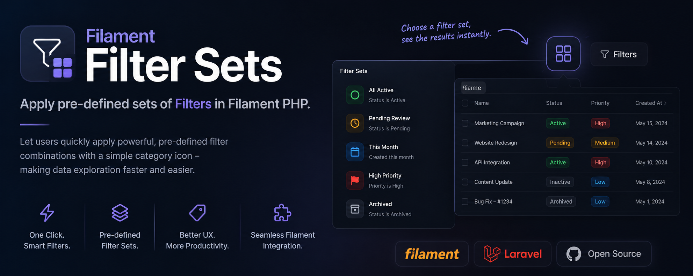

# Filament Filter Sets



[](https://packagist.org/packages/kingmaker/filament-filter-sets)

[](https://filamentphp.com/)
[](https://github.com/kingmaker-agm/filament-filter-sets/actions/workflows/run-tests.yml)
[](https://opensource.org/licenses/MIT)

Predefined **filter sets** for Filament tables — apply a whole combination of table filters in one
click, from a dropdown in the table toolbar.

A filter set is a named bundle of filter state. Instead of asking a user to open the filters panel
and set four fields to find "unread quick reads", you declare that combination once and they pick it
from a list.

## Requirements

| Package | Filament | Laravel | PHP  |
|---------|----------|---------|------|
| 1.x     | 4 or 5   | 11.28+  | 8.2+ |

## Installation

```bash
composer require kingmaker/filament-filter-sets
```

The service provider is auto-discovered. There is nothing to publish and no trait to add.

## Usage

Call `filterSets()` on the table, alongside your existing `filters()`:

```php
use Filament\Tables\Table;
use Filament\Tables\Filters\TernaryFilter;
use Kingmaker\Filament\FilterSets\FilterSet;

public function table(Table $table): Table
{
    return $table
        ->filters([
            TernaryFilter::make('is_published'),
            // ...
        ])
        ->filterSets([
            FilterSet::make('unread_quick_reads')
                ->label('Unread Quick Reads')
                ->icon('heroicon-o-rocket-launch')
                ->filters([
                    'is_read' => ['value' => false],
                    'read_time' => ['read_time_range' => 'quick'],
                ]),

            FilterSet::make('loved_stories')
                ->icon('heroicon-s-heart')
                ->color('danger')
                ->filters([
                    'min_rating' => ['rating_clause' => 'greater_equal', 'rating_value' => 4],
                ]),
        ]);
}
```

A swatch icon appears next to the table's search field. Opening it lists every set; clicking one
applies it.

### The `FilterSet` API

| Method | Description |
|--------|-------------|
| `make(string $name)` | Creates the set. The name is also the identifier passed to `applyTableFilterSet()`. |
| `label(string $label)` | The text in the dropdown. Defaults to `Str::headline($name)` — `unread_quick_reads` becomes `Unread Quick Reads`. |
| `icon(string\|BackedEnum\|null $icon)` | An icon for the dropdown item. Accepts an icon name or Filament's `Heroicon` enum. |
| `color(?string $color)` | A Filament colour for the dropdown item, e.g. `success`. |
| `filters(array\|Closure $filters)` | The filter form state to apply, keyed by filter name. |

The array passed to `filters()` is the same shape the table's filters form uses: the outer key is
the filter name, the inner array is that filter's own form state. A filter with a single field —
like `TernaryFilter` — takes `['value' => ...]`; a custom `Filter` with a schema takes one key per
field.

### Runtime values

`filters()` also accepts a `Closure`, resolved every time the set is read. Use it for anything that
depends on the current request:

```php
FilterSet::make('my_drafts')
    ->filters(fn (): array => [
        'author' => ['value' => auth()->id()],
        'is_published' => ['value' => false],
    ]),
```

### Applying a set programmatically

Every component with a table gains a virtual `applyTableFilterSet()` method, so you can trigger a
set from your own Blade or Livewire code:

```blade
<x-filament::button wire:click="applyTableFilterSet('loved_stories')">
    Loved stories
</x-filament::button>
```

## Behaviour

- **Sets replace, they do not merge.** The filters form is reset to its defaults before a set is
  applied, so switching from one set to another never leaves a stray filter behind.
- **State is filled through the schema**, not assigned to the Livewire property, so each field's
  state casts run. This is what makes a ternary `false` render as the selected `No` option rather
  than falling back to the placeholder.
- **Deferred and live filters are both supported.** If the table defers its filters, the set is
  applied through `applyTableFilters()`; otherwise through `updatedTableFilters()`.
- **Unknown set names are ignored** — calling `applyTableFilterSet('nope')` leaves the filters
  exactly as they were.


## Customisation

Publish the trigger view to change the icon, placement or markup:

```bash
php artisan vendor:publish --tag=filament-filter-sets-views
```

Publish the translations to change the trigger's label, or to translate it:

```bash
php artisan vendor:publish --tag=filament-filter-sets-translations
```

## Testing

Filter sets are exercised like any other Livewire call:

```php
Livewire::test(ListStories::class)
    ->call('applyTableFilterSet', 'loved_stories')
    ->assertCanSeeTableRecords([$lovedStory])
    ->assertCanNotSeeTableRecords([$mediocreStory]);
```

To run this package's own suite:

```bash
composer install
composer test
```

## Changelog

See [CHANGELOG.md](CHANGELOG.md).

## License

The MIT License (MIT). See [LICENSE.md](LICENSE.md).
